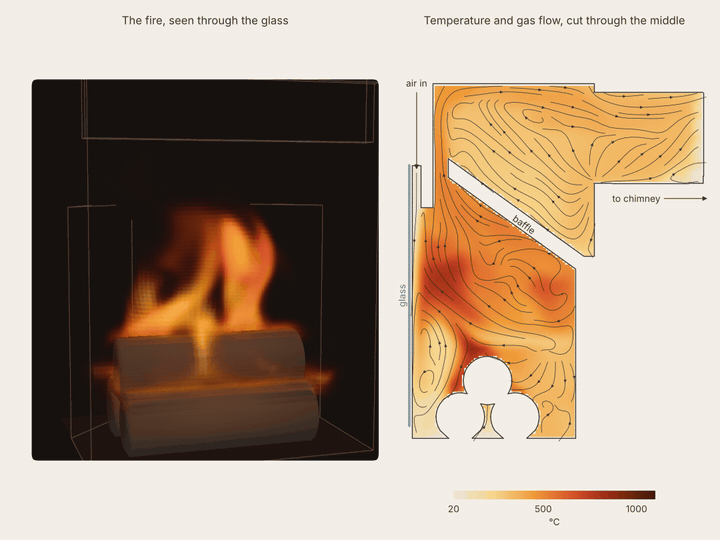

# stove-fire-openfoam

3D OpenFOAM simulation of a wood fire inside a Wiking Miro 3 stove at nominal burn
(4.9 kW). The flame, the hot gas path around the baffle and the heat leaving through
the glass, the lining and the chimney are all resolved in time.



*Left: the flame as seen through the glass. Right: temperature and gas flow in a slice through the middle of the stove. Fresh air comes down along the glass, the hot gas passes the front edge of the baffle and turns back before it leaves for the chimney.*

* Stove: Wiking Miro 3, 4.9 kW, three logs of 8 x 24 cm, 12 Pa chimney draught
* Solver: `fireFoam`, LES (k-equation), eddy-dissipation combustion, fvDOM radiation
* Walls: conduction through vermiculite, steel and ceramic glass to a 20 °C room
* Mesh: `blockMesh` + `snappyHexMesh`, 7.5 mm cells (113k)

## Requirements

* OpenFOAM v2306 or newer (openfoam.com)

## Usage

```sh
cd case
./Allrun -np 4      # mesh and solve, 20 s of fire
./Allclean
```

Fuel power, air split and wall properties are set in `case/system/caseParams`, the
cell size in `case/system/blockMeshDict`.

## Credits

Operating point (heat output, efficiency, flue gas flow and temperature, draught, log
size) from the Wiking Miro installation and user manual. Solver settings started from
the OpenFOAM tutorial `combustion/fireFoam/LES/smallPoolFire3D`.

## License

MIT, see `LICENSE`.
